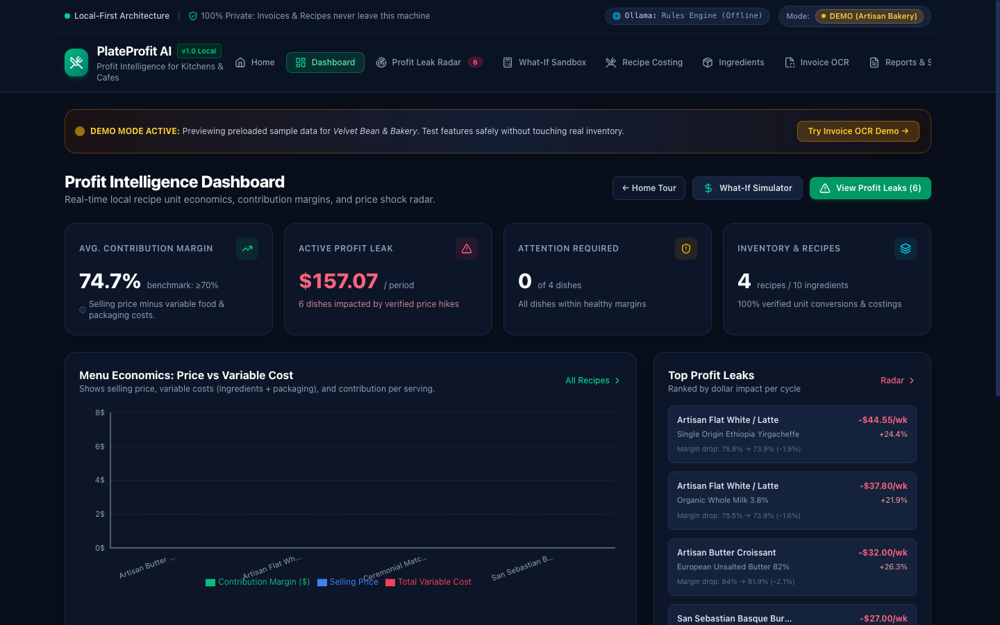
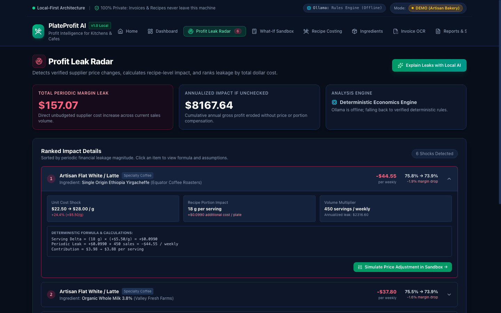
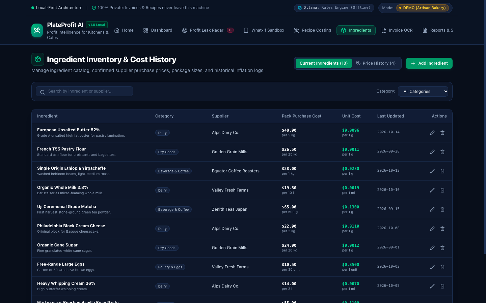
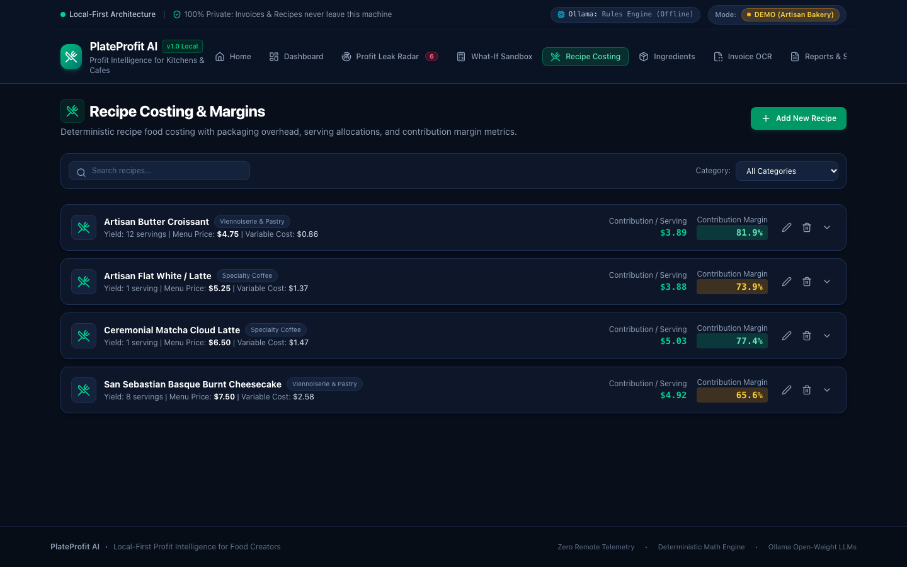
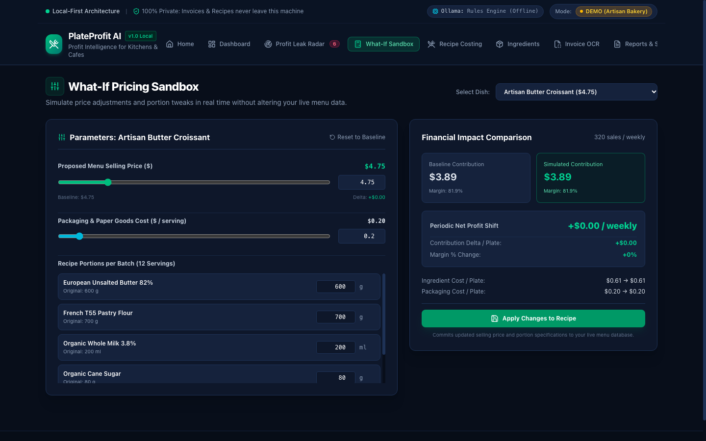
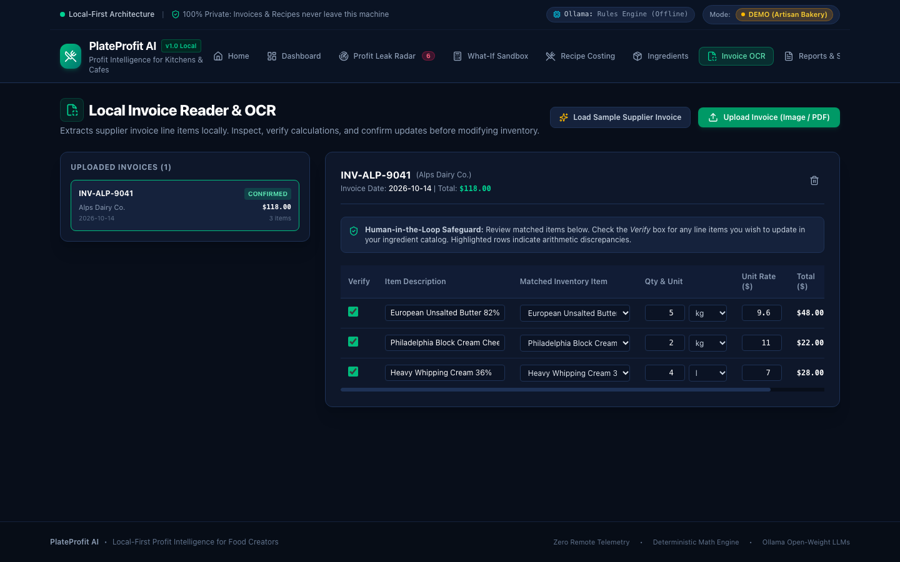
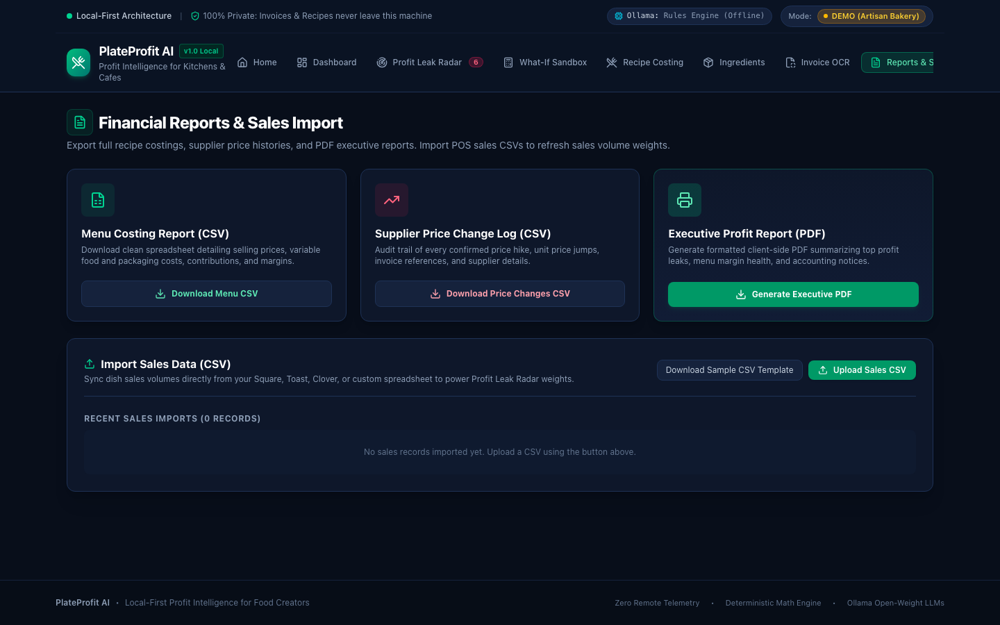

# 🍽️ PlateProfit AI

> **Local-First Food Cost & Profit Intelligence for Cafes, Cloud Kitchens, Food Stalls, and Home Bakers**

[](https://www.typescriptlang.org/)
[](https://nextjs.org/)
[](https://tailwindcss.com/)
[](https://vitest.dev/)
[](https://ollama.ai/)
[](#-privacy-architecture)
[](LICENSE)

PlateProfit AI is a high-precision, privacy-first cost intelligence platform built specifically for independent food businesses. It detects hidden **profit leaks** caused by fluctuating wholesale ingredient prices, calculates accurate batch and per-serving contribution margins down to the gram, extracts invoice line-items locally with OCR, runs what-if menu pricing simulations, and leverages local Ollama open-weight LLMs for contextual financial explanations—without any sensitive business data ever leaving your device.

---

## 📸 Screenshots

| Feature View | Screenshot |
| :--- | :--- |
| **Executive Dashboard**<br>Live revenue, COGS, contribution margin %, urgent repricing alerts, and menu economics. |  |
| **Profit Leak Radar**<br>Cross-references wholesale price increases against active recipes to quantify weekly and annualized bottom-line leaks. |  |
| **Ingredient & Inventory Catalog**<br>Base unit cost normalization (`g`, `ml`, `piece`) with auditable historical price inflation logs. |  |
| **Deterministic Recipe Costing**<br>Batch yield configuration, unit conversion engine, packaging overhead, and per-serving unit economics. |  |
| **What-If Scenario Simulator**<br>Interactive sandbox to test selling prices and ingredient portioning tweaks before updating live menus. |  |
| **In-Browser Invoice OCR**<br>Client-side text parsing with human-in-the-loop review before updating ingredient prices. |  |
| **Financial Reports & Exports**<br>Menu costing CSV downloads, price change audit logs, sales POS import, and printable executive PDF reports. |  |

---

## 🌟 Verified Features & Implementation Status

| Feature Module | Status | Description |
| :--- | :---: | :--- |
| **Local-First Executive Dashboard** | ✅ Production | Computes average contribution margin %, active profit leaks ($/period), urgent repricing counts, and menu economics bar charts. |
| **Ingredient Inventory & Price History** | ✅ Production | Normalized cost-per-base-unit calculation (`g`, `ml`, `piece`), vendor metadata, and historical price hike audit logs. |
| **Deterministic Recipe Costing Engine** | ✅ Production | Exact multi-unit batch costing (`kg` ↔ `g` ↔ `lb` ↔ `oz`, `l` ↔ `ml` ↔ `fl oz`), packaging allocations, and contribution margin % calculation. |
| **Profit Leak Radar** | ✅ Production | Automatically matches verified ingredient price changes to affected recipes, multiplies by periodic sales volume, and ranks bottom-line leaks. |
| **In-Browser Invoice OCR Ingestion** | ✅ Production | Local OCR via Tesseract.js. Highlights line items with uncertainty indicators and enforces human verification before saving. |
| **Interactive What-If Simulator** | ✅ Production | Real-time slider sandboxing of selling prices, ingredient portions, and packaging with instant margin and periodic profit delta comparisons. |
| **CSV Import / Export & PDF Reporting** | ✅ Production | One-click CSV export for recipe costing and supplier price histories; formatted executive PDF reports via jsPDF; POS sales CSV import. |
| **Local Ollama AI Integration** | ✅ Production | Connects to local Ollama daemon (`http://localhost:11434`) via secure local API proxy. Features rule-based fallback when Ollama is offline. |

---

## 🛠️ Technology Stack

- **Framework**: [Next.js](https://nextjs.org/) 16.4.2 (App Router, Turbopack)
- **Language**: [TypeScript](https://www.typescriptlang.org/) 5.x (Strict type safety)
- **Runtime & UI**: [React](https://react.dev/) 19.3.0
- **Styling**: [Tailwind CSS](https://tailwindcss.com/) 4.x
- **Icons**: [Lucide React](https://lucide.dev/) (v1.58.0)
- **Data Visualization**: [Recharts](https://recharts.org/) (v3.10.1)
- **Client-Side OCR**: [Tesseract.js](https://github.com/naptha/tesseract.js) (v7.0.0)
- **Client-Side PDF Generation**: [jsPDF](https://github.com/parallax/jsPDF) (v4.2.1)
- **Testing**: [Vitest](https://vitest.dev/) (v5.0.5)
- **Code Quality**: [ESLint](https://eslint.org/) 9 with `eslint-config-next`
- **Local AI Engine**: [Ollama](https://ollama.ai/) REST API (Supports `llama3.2`, `mistral`, `gemma2`)

---

## 🔒 Privacy Architecture

```mermaid
graph TD
    UI[Next.js App Router UI] --> Context[React AppContext]
    Context --> Storage[(Local Sandbox Storage)]
    Context --> Engine[Deterministic Financial & Unit Engine]
    Context --> OCR[Local Browser OCR / Text Extractor]
    Context --> API[/api/ollama/analyze Proxy]
    API --> Ollama[(Local Ollama Daemon :11434)]
    
    subgraph Zero-Cloud Perimeter
      Storage
      Engine
      OCR
      Ollama
    end
```

- **100% Local Storage**: All ingredient costs, menu items, sales records, recipes, and invoices are stored exclusively in your browser's local sandbox storage (`localStorage`).
- **Zero Cloud Telemetry**: No third-party tracking pixels, external databases, analytics beacons, or remote cloud synchronizations are installed.
- **Air-Gapped AI Compatibility**: Local LLM inference queries communicate strictly with your local Ollama port (`127.0.0.1:11434`). No business financials are ever sent to OpenAI, Anthropic, or external cloud APIs.

---

## 📂 Project Structure

```text
PlateProfit AI/
├── .env.example              # Example environment configuration (local-first)
├── .gitignore                # Git exclusions (build, cache, sensitive files)
├── eslint.config.mjs         # ESLint configuration
├── LICENSE                   # MIT License
├── next.config.ts            # Next.js configuration
├── package.json              # Project dependencies and npm scripts
├── package-lock.json         # Pinned dependency lockfile
├── README.md                 # Complete project documentation
├── tsconfig.json             # TypeScript configuration
├── vitest.config.ts          # Vitest testing configuration
├── public/                   # Static SVG assets
├── screenshots/              # Real application screenshots
│   ├── dashboard.png
│   ├── home.png
│   ├── inventory.png
│   ├── invoices.png
│   ├── radar.png
│   ├── recipes.png
│   ├── reports.png
│   └── whatif.png
└── src/
    ├── app/
    │   ├── api/
    │   │   └── ollama/
    │   │       ├── analyze/route.ts  # Local proxy for Ollama invoice & profit explanations
    │   │       └── status/route.ts   # Local Ollama health check & model detection
    │   ├── favicon.ico
    │   ├── globals.css               # Global Tailwind CSS styles
    │   ├── layout.tsx                # Root layout with font and metadata
    │   └── page.tsx                  # Main single-page application shell
    ├── components/
    │   ├── dashboard/DashboardView.tsx      # Overview KPIs, margin charts & top leaks
    │   ├── home/HomeView.tsx                # Hero introduction & feature showcase
    │   ├── inventory/InventoryView.tsx      # Ingredients directory & price change history
    │   ├── invoices/InvoiceReaderView.tsx   # Tesseract OCR invoice reader & review table
    │   ├── layout/Navbar.tsx                # Navigation bar with Ollama status & demo mode toggle
    │   ├── providers/ClientProviders.tsx    # App context provider wrapper
    │   ├── radar/ProfitLeakRadarView.tsx    # Profit leak quantification & impact ranking
    │   ├── recipes/RecipesView.tsx          # Batch costing, packaging & margin calculation
    │   ├── reports/ReportsView.tsx          # CSV imports/exports & PDF report generator
    │   ├── settings/SettingsView.tsx        # Ollama config, backup import/export, data reset
    │   └── whatif/WhatIfView.tsx            # What-if price and recipe sandboxing simulator
    ├── context/
    │   └── AppContext.tsx            # Central state management & local storage persistence
    ├── lib/
    │   ├── __tests__/
    │   │   ├── costing.test.ts       # Deterministic costing math & profit leak unit tests
    │   │   ├── ocr.test.ts           # Invoice parsing regexes & normalization tests
    │   │   └── reports.test.ts       # CSV escaping and generation unit tests
    │   ├── costing.ts                # Deterministic cost, yield & profit leak math engine
    │   ├── demoData.ts               # Synthetic bakery dataset (croissants, flat whites, etc.)
    │   ├── ocr.ts                    # In-browser OCR wrapper & invoice line-item parser
    │   ├── reports.ts                # CSV generator/parser & jsPDF report builder
    │   ├── ruleBasedAdvisor.ts       # Offline heuristic advisor when Ollama is unavailable
    │   ├── storage.ts                # Local storage key abstractions & serialization
    │   └── units.ts                  # Unit conversion engine (kg, g, lb, oz, l, ml, fl oz)
    └── types/
        └── index.ts                  # Shared TypeScript data models and interfaces
```

---

## ⚡ Prerequisites & Installation

### Prerequisites
- **Node.js**: v18.17.0 or later (v20+ recommended)
- **Package Manager**: `npm`, `pnpm`, or `yarn`
- **Ollama** (optional, for local AI insights): [ollama.ai](https://ollama.ai)

### 1. Clone the Repository
```bash
git clone https://github.com/azmolwasimhussain-ops/PlateProfit-AI.git
cd PlateProfit-AI
```

### 2. Install Dependencies
```bash
npm install
```

### 3. Environment Configuration
PlateProfit AI is 100% local-first and does not require cloud API keys. An example configuration is provided in `.env.example`:
```bash
cp .env.example .env.local
```

---

## 🚀 Running the Application

### Development Server
```bash
npm run dev
```
Open [http://localhost:3002](http://localhost:3002) in your browser.

### Production Build & Launch
```bash
# Build the optimized production bundle
npm run build

# Start the production server
npm start
```

---

## 🧪 Testing & Code Quality

PlateProfit AI includes a test suite covering deterministic mathematical costing, OCR regex extraction, and CSV generation:

```bash
# Run unit tests with Vitest (14 tests)
npm test

# Run ESLint to verify code quality
npm run lint

# Run TypeScript type check
npx tsc --noEmit
```

### Verified Test Coverage
- **`costing.test.ts`**: Verifies batch yield calculations, per-serving variable food cost, packaging cost inclusions, contribution margin formulas ($S - V$), handling of zero/negative selling prices, and profit leak multipliers.
- **`ocr.test.ts`**: Verifies invoice line item regex extraction, pack size and unit parsing (`5kg`, `4L`, `250g`), currency formatting, and numeric sanitization.
- **`reports.test.ts`**: Verifies RFC 4180 CSV generation, column escaping for quotes/commas, and data export accuracy.

---

## 🦙 Local Ollama AI Setup (Optional)

PlateProfit AI features an AI analysis layer that runs on-device using Ollama. When Ollama is offline or unavailable, the application automatically falls back to its deterministic rule-based financial advisor.

### Setup Steps
1. Install Ollama from [ollama.ai](https://ollama.ai).
2. Pull a recommended lightweight model:
   ```bash
   # Fast, highly capable 3B model (recommended):
   ollama pull llama3.2

   # Alternative compact model:
   ollama pull mistral
   ```
3. Start the Ollama daemon:
   ```bash
   ollama serve
   ```
4. In PlateProfit AI, navigate to **Settings & AI** and click **Test Ollama Connection**.

---

## 📊 Fictional Sample Dataset

PlateProfit AI includes a pre-loaded, **strictly fictional demonstration dataset** (artisan bakery / specialty cafe) to showcase system capabilities:

> [!NOTE]
> All business names, vendor names, ingredient prices, sales quantities, and menu recipes below are completely synthetic and for demonstration purposes only.

### Sample Ingredients
| Ingredient Name | Category | Supplier | Pack Size | Pack Cost | Cost / Unit |
| :--- | :--- | :--- | :--- | :--- | :--- |
| **European Unsalted Butter (82%)** | Dairy | Alps Dairy Co. | 5 kg | $48.00 | $0.0096 / g |
| **French T55 Pastry Flour** | Dry Goods | Golden Grain Mills | 25 kg | $26.50 | $0.0011 / g |
| **Organic Whole Milk 3.8%** | Dairy | Valley Fresh Farms | 10 L | $19.50 | $0.0019 / ml |
| **Single Origin Ethiopia Yirgacheffe**| Beverage | Equator Coffee Roasters | 1 kg | $28.00 | $0.0280 / g |
| **Organic Cane Sugar** | Dry Goods | Golden Grain Mills | 20 kg | $24.00 | $0.0012 / g |
| **Free-Range Large Eggs** | Poultry & Eggs | Valley Fresh Farms | 30 units | $10.50 | $0.3500 / unit |

### Sample Menu Recipes
| Recipe Name | Category | Yield | Cost / Srv | Packaging | Selling Price | Margin % | Weekly Vol |
| :--- | :--- | :--- | :--- | :--- | :--- | :--- | :--- |
| **Artisan Butter Croissant** | Pastry | 12 | $0.86 | $0.20 | $4.75 | **81.9%** | 320 |
| **Artisan Flat White / Latte** | Beverage | 1 | $1.37 | $0.25 | $5.25 | **73.9%** | 450 |
| **Ceremonial Matcha Cloud Latte** | Beverage | 1 | $1.47 | $0.28 | $6.50 | **77.4%** | 180 |
| **San Sebastian Basque Cheesecake** | Pastry | 8 | $2.58 | $0.35 | $7.50 | **65.6%** | 90 |

---

## 🌐 Community Wisdom & Proven Patterns

In developing PlateProfit AI's local-first architecture and deterministic financial pipeline, we drew inspiration from proven industry implementations documented on DEV:

- **[Building a Privacy-First Local AI Assistant: A Developer's Guide to Open-Weight Models](https://dev.to/tamizuddin/building-a-privacy-first-local-ai-assistant-a-developers-guide-to-open-weight-models-334m)** by [Tamizuddin](https://dev.to/tamizuddin): Deep dive into sandboxing Ollama requests, handling model timeouts, and preventing data exfiltration in client applications.
- **[Offline-First React: TanStack Query + IndexedDB Patterns](https://dev.to/nainikmehta/offline-first-react-tanstack-query-indexeddb-patterns-13o4)** by [Nainik Mehta](https://dev.to/nainikmehta): Architectural patterns for resilient local-first state persistence, hydration handling, and zero-cloud resilience.
- **[How I Built a Privacy-First AI Assistant That Runs 100% Locally with Node.js and Ollama](https://dev.to/davesimoes/how-i-built-a-privacy-first-ai-assistant-that-runs-100-locally-with-nodejs-and-ollama-3c6a)** by [Dave Simoes](https://dev.to/davesimoes): Practical guidance on structuring local proxy endpoints and graceful offline fallbacks when local daemons are unreachable.

---

## ⚠️ Known Limitations

1. **OCR on Hand-Written Invoices**: Tesseract.js client-side OCR excels on machine-printed supplier invoices and delivery dockets. Faded carbon copies or handwritten tickets may require quick manual adjustments via the inline editor before confirming.
2. **Local AI Model Latency**: Inference speed depends on host hardware (Apple Silicon unified memory delivers sub-second replies; CPU-only machines may take 4–8 seconds).
3. **Single-Device Local Storage**: Operates as a pure local-first single-device web application. To transfer data across workstations, use the **Export Full JSON Backup** and **Import Backup** tools in Settings.

---

## 👤 Author

- **Azmol Wasim Hussain**
- **GitHub**: [@azmolwasimhussain-ops](https://github.com/azmolwasimhussain-ops)
- **Repository**: [https://github.com/azmolwasimhussain-ops/PlateProfit-AI](https://github.com/azmolwasimhussain-ops/PlateProfit-AI)

---

## 📜 License

Distributed under the MIT License. See [LICENSE](LICENSE) for more information.
